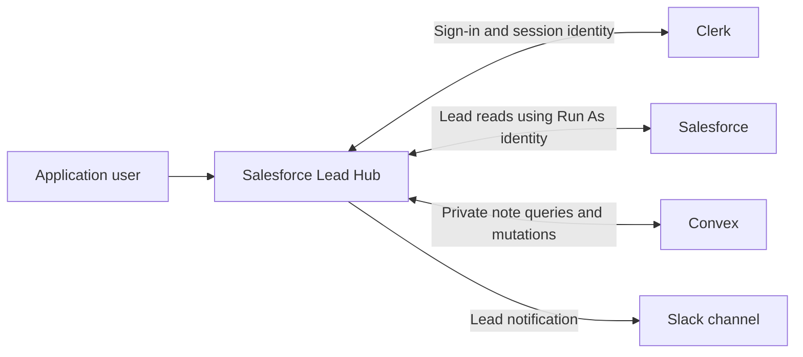
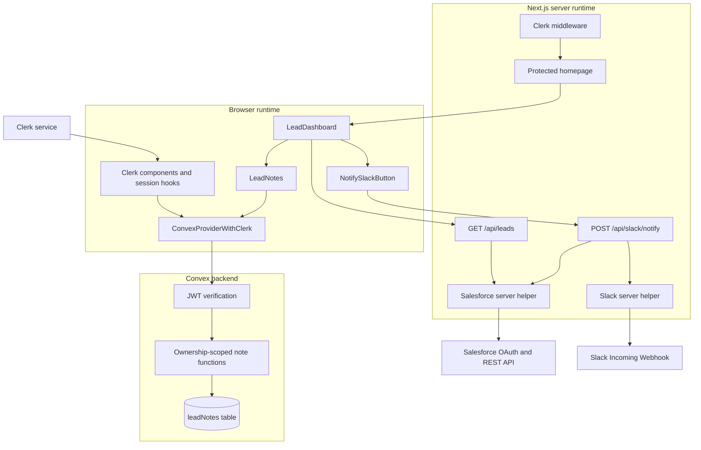
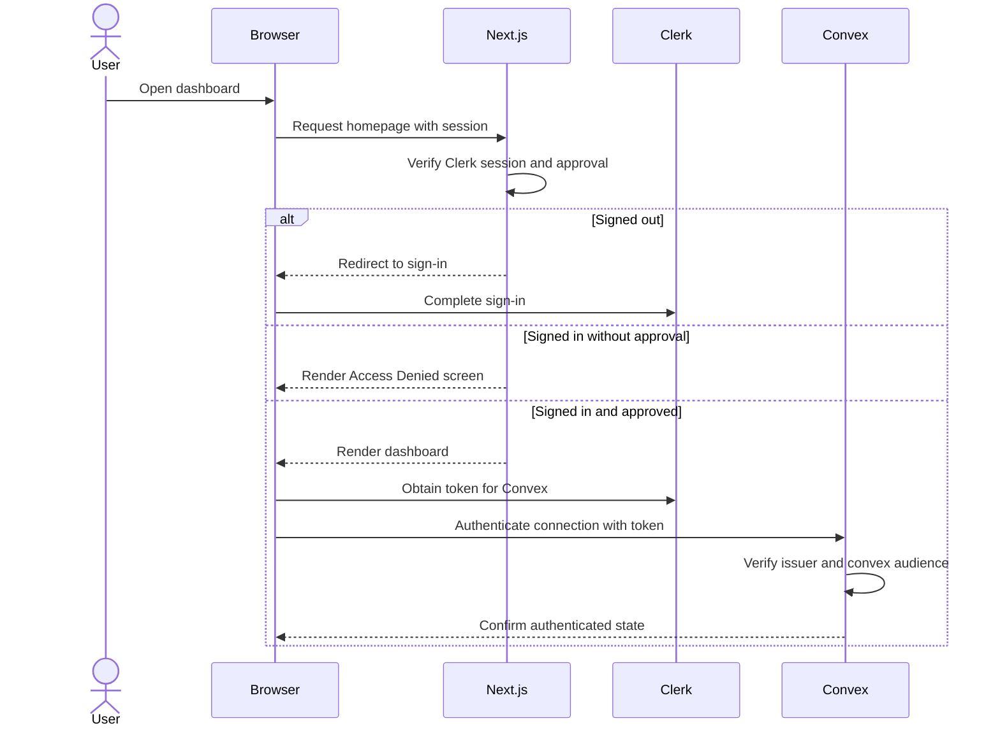
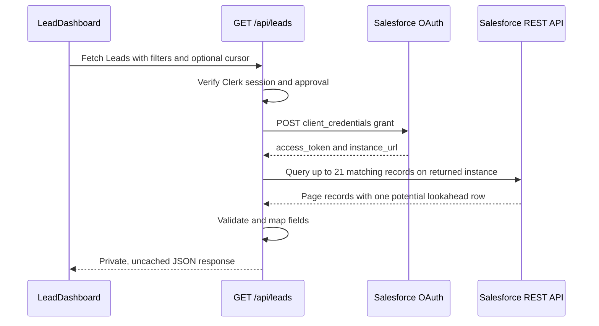
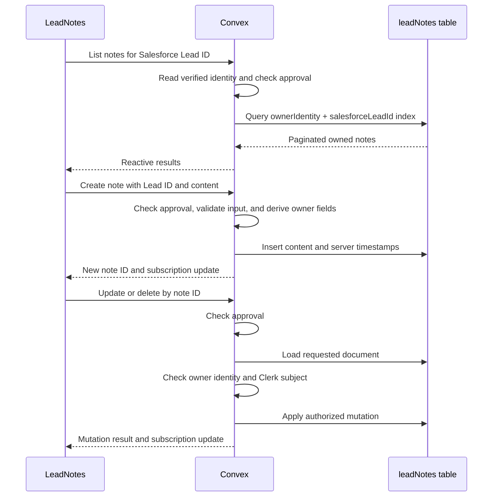
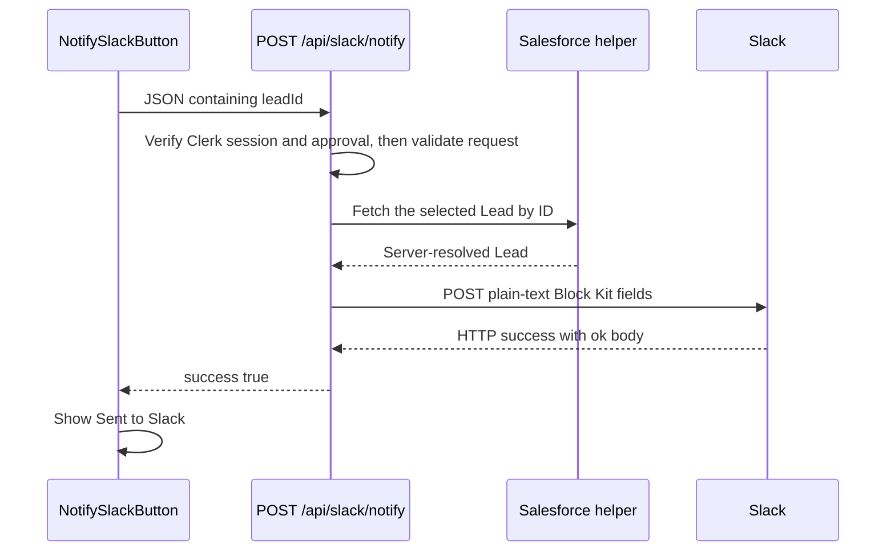

<!-- Describes the Lead Hub architecture, integrations, data model, and deployment. -->

# Salesforce Lead Hub technical project guide

| Document attribute | Value |
| --- | --- |
| System | Salesforce Lead Hub |
| Audience | Developers, engineering leads, and solution architects |
| Scope | Application structure, integration contracts, data ownership, security, and local operation |
| Architecture style | Single-tenant Next.js application with an authenticated Convex notes backend |

## 1. Purpose and architectural goals

Salesforce Lead Hub gives approved users a workspace for viewing Salesforce Leads, maintaining private notes, and sending selected Lead details to Slack.

The architecture supports four core capabilities.

- Authenticate users through Clerk and enforce application approval in Next.js and Convex.
- Retrieve Salesforce Leads in pages of 20 using the configured integration user's permissions.
- Persist private notes in Convex with ownership enforced on the backend.
- Send user-triggered notifications to a configured Slack channel.

This document describes implemented behavior. Architectural rationale in the decision table is inferred from the source code. The hosted portfolio demo is described in Section 14. A production rollout would require a review of identity configuration, operational controls, and service-level targets.

## 2. System context

The application integrates with Clerk for identity, Salesforce for CRM records, Convex for note persistence, and Slack for notifications.



The application has one Salesforce integration identity and one Slack destination. Every approved Clerk user receives the Salesforce view permitted to the configured Run As user. Note ownership is scoped independently to each verified Clerk identity.

## 3. Runtime containers and trust boundaries



| Boundary | Input crossing it | Enforcement |
| --- | --- | --- |
| Browser → Next.js page | Clerk session | Clerk session and approved-user checks before dashboard rendering |
| Browser → Leads API | Authenticated request | Clerk session and approved-user checks before Salesforce access |
| Browser → Slack API | Clerk session and Lead ID | Clerk session and approved-user checks, Origin check when supplied, JSON validation, and server-side Lead resolution |
| Browser → Convex | Clerk token and function arguments | JWT issuer/audience verification, approved-user check, argument validators, and ownership checks |
| Next.js → Salesforce | Integration credentials, then a bearer token | HTTPS origin validation, bounded SOQL queries, redirect rejection, and request timeouts |
| Next.js → Slack | Lead notification payload | Validated webhook destination, redirect rejection, timeout, and delivery-response validation |

### Runtime responsibilities

| Runtime or service | Responsibility | Data handled |
| --- | --- | --- |
| Browser | Dashboard, search/filter state, note forms, delivery feedback | Lead fields, owned notes, transient input, and browser authentication state |
| Next.js server | Protect pages/endpoints and orchestrate Salesforce/Slack requests | Server credentials, temporary Salesforce token, Lead responses, and Slack webhook |
| Clerk | User accounts, sessions, and signed identity tokens | Account and session data |
| Convex | Verify identity and execute reactive, transactional note operations | Owner metadata, Lead references, content, and timestamps |
| Salesforce | Authoritative CRM data and integration access permissions | Lead records and Run As authorization |
| Slack | Deliver selected Lead information to the configured channel | Notification copies of selected Lead fields |

## 4. Runtime interaction flows

### 4.1 Application authentication

`RootLayout` wraps the app in `ClerkProvider` and then `ConvexClientProvider`. Clerk middleware makes session information available to server requests. The homepage and API endpoints check the Clerk session and approved-user list on the server.



The Next.js APIs require a verified Clerk session and an approved Clerk user ID. The notes UI additionally waits for Convex to confirm its token. An unreachable Convex backend can therefore leave notes waiting while Salesforce data continues to load.

### 4.2 Salesforce Lead retrieval



Each helper invocation obtains a fresh token. The server query sorts by `CreatedDate DESC, Id DESC` and selects `Id`, `Name`, `Company`, `Email`, and `Status`. Salesforce applies search, status, and cursor filters. The dashboard summary cards count the rows currently loaded.

### 4.3 Private Lead notes



The browser supplies the Lead reference and note text. Convex derives ownership from the verified token. Saved notes survive browser refresh because the next subscription reads persisted Convex documents.

### 4.4 Slack notification



The Slack route resolves current Lead content on the server. The selected record must remain visible to the Salesforce integration user. Slack delivery is a separate external operation from Convex notes and Salesforce reads.

## 5. Architectural decisions and consequences

The rationale below explains the current design based on its implementation.

| Decision | Rationale | Consequence |
| --- | --- | --- |
| Next.js App Router with client components for interactions | Keep route authentication on the server and local UI state close to the controls | Browser components call authenticated interfaces for backend work |
| Clerk as the shared identity provider | Reuse the same account/session identity across Next.js and Convex | Convex issuer and audience configuration must match the Clerk application |
| Convex queries and mutations for private notes | Combine persistent storage, transactions, and reactive updates | Note availability depends on the Convex connection |
| Owner-and-Lead compound index | Scope every list query to the verified identity and selected Lead | User isolation is enforced in the query itself |
| Salesforce client credentials with one Run As user | Support the configured server-to-server CRM integration | Approved users share one Salesforce permission scope |
| Server-only Salesforce and Slack helpers | Keep integration credentials within the server runtime | External calls pass through authenticated Next.js endpoints |
| Filtered SOQL with cursor pagination | Bound each dashboard request and sort consistently by creation date and ID | Users can load more matching records in pages of 20 |
| Fresh Salesforce token on each helper invocation | Keep token lifecycle local to each operation | Dashboard retrieval and Slack notification each perform an OAuth exchange |
| Server-side lookup before Slack delivery | Use current Salesforce fields as the notification source | Notifications add another Salesforce read and can reject a stale selection |
| Component-local Slack send state | Provide immediate feedback and prevent overlapping UI clicks | Reloads and separate requests can produce additional notifications |

## 6. Data ownership and access model

Salesforce owns the authoritative Lead fields. Convex owns private note documents. Slack receives a message copy of selected Lead fields. The Salesforce Lead ID connects the dashboard records and note documents across these systems.

There is no cross-system transaction covering Salesforce, Convex, and Slack. A note mutation commits within Convex. Slack acknowledges its own delivery independently. Salesforce permissions or record availability can change while related notes remain persisted.

The following sections specify the schema, integration contracts, and security enforcement used by these flows.

## 7. Identity and authentication architecture

Clerk's server and browser APIs serve different parts of the request flow.

1. `ClerkProvider` supplies the browser session to Clerk components and hooks.
2. `proxy.ts` runs `clerkMiddleware()` for application routes and API paths.
3. `Home` redirects signed-out visitors to Clerk sign-in and renders an Access Denied screen for signed-in users without approval.
4. Both API handlers use [getLeadHubAccessStatus](../src/lib/authorization.ts) and return `401` for signed-out requests or `403` when the Clerk user ID is absent from the allowlist.
5. `ConvexProviderWithClerk` obtains a Clerk token for Convex and passes it to the Convex client.
6. Convex verifies the token using the issuer and `convex` audience configured in `convex/auth.config.ts`. The notes functions and auth diagnostic then check the verified Clerk user ID against the backend allowlist.

A working Clerk sign-in can coexist with a pending Convex connection. Salesforce API requests require an approved Clerk session. Notes additionally require Convex to verify the token and approve the ID in its own environment.

[app/convex-client-provider.tsx](../app/convex-client-provider.tsx) creates one `ConvexReactClient` from `NEXT_PUBLIC_CONVEX_URL` and connects it to Clerk's `useAuth` hook. A missing URL throws an explicit configuration error.

The installed Convex Clerk adapter supports the Clerk Convex integration when the session audience is `convex`, and otherwise requests the Clerk JWT template named `convex`. Configure the integration or template for the same Clerk instance used by the application.

### Multiple Clerk users and shared Salesforce access

Clerk can register and authenticate multiple application users. After sign-in, an approved user can request the shared Salesforce Lead view through the protected Next.js endpoint. Salesforce evaluates those requests using the External Client App's configured Run As identity.

| Concern | Identity or permission source |
| --- | --- |
| Who can create an account and sign in | Clerk Invite-only admission and account settings |
| Who can call the Salesforce Leads endpoint | A valid Clerk session and a user ID in the Next.js allowlist |
| Which Salesforce Leads and fields can be returned | Salesforce permissions of the configured Run As user |
| Who owns a private note | Verified Clerk identity received by Convex |
| Who can trigger a Slack notification | A valid Clerk session and a user ID in the Next.js allowlist, followed by server-side Lead lookup |

Clerk invitations control account admission. Application access requires the Clerk user ID to be present in `AUTHORIZED_CLERK_USER_IDS` for the backend serving the request. A missing or blank setting grants no access.

### Why Client Credentials Flow fits this application

The Next.js server connects to Salesforce as a server-to-server integration. It exchanges the External Client App's client ID and secret for an access token associated with the configured Run As user. Users sign in to Lead Hub through Clerk, and the server performs Salesforce requests for the shared workspace.

This arrangement supports the single-tenant dashboard with one Salesforce organization, one integration permission scope, and multiple Clerk users. Salesforce credentials stay in the Next.js server environment. Each user's notes are independently scoped through Convex ownership checks.

### When individual Salesforce accounts become relevant

| Requirement | Reason for per-user Salesforce authorization |
| --- | --- |
| Salespeople and managers need different Lead visibility | Salesforce can enforce the records and fields available to each connected employee |
| Future Salesforce writes need individual audit attribution | Changes can be attributed to the employee's authorized Salesforce identity |
| Customers connect different Salesforce organizations | Each connection must identify the relevant organization and its authorized user |
| Salesforce account revocation must control access through Lead Hub | Salesforce authorization can follow the individual employee's account status and token validity |

Those requirements would call for per-user Salesforce OAuth authorization, an association between the Clerk user and Salesforce connection, and secure server-side token lifecycle management. Connecting multiple customer organizations would also require extending the current single-tenant data and access model. Clerk would continue to authenticate application users, while the linked Salesforce identity would determine their CRM access.

## 8. Persistence architecture and note contracts

### Schema

[convex/schema.ts](../convex/schema.ts) defines `leadNotes`.

| Field | Type | Assigned by |
| --- | --- | --- |
| `_id` | Convex document ID | Convex |
| `_creationTime` | System creation timestamp | Convex |
| `salesforceLeadId` | String | Lead ID supplied by the client and format-validated on the backend |
| `clerkUserId` | String | Verified token `identity.subject` |
| `ownerIdentity` | String | Verified token `identity.tokenIdentifier`, incorporating issuer and subject |
| `content` | String | Trimmed note text, 1–5,000 characters |
| `createdAt` | Number | Backend `Date.now()`, milliseconds since the Unix epoch |
| `updatedAt` | Number | Backend `Date.now()` on creation and editing |

The compound index `by_ownerIdentity_and_salesforceLeadId` supports reads for one verified owner and one Lead. Listing orders results newest first by Convex creation order.

### Public functions

All public note functions use argument and return validators. Their implementations are in [convex/leadNotes.ts](../convex/leadNotes.ts).

| Function | Arguments | Result | Access enforcement |
| --- | --- | --- | --- |
| `api.leadNotes.list` | `salesforceLeadId`, `paginationOpts` | Paginated owned documents | Requires an approved identity and queries the owner/Lead compound index |
| `api.leadNotes.create` | `salesforceLeadId`, `content` | New note ID | Requires an approved identity and derives both owner fields from it |
| `api.leadNotes.update` | `noteId`, `content` | `null` | Requires approval, then loads the document and checks both owner identity and Clerk subject before editing |
| `api.leadNotes.remove` | `noteId` | `null` | Requires approval, then loads the document and checks both owner fields before deletion |
| `api.authTest.viewer` | None | `{ subject, issuer }` | Requires an approved Clerk identity |

[requireApprovedClerkIdentity](../lib/convex-authorization.ts) rejects signed-out or unapproved callers before note reads or writes. `requireOwnedNote` uses the same error for an absent note and another user's note. Clients cannot change owner fields or the Lead association through an update.

Lead IDs must use the `00Q` prefix and have 15 or 18 alphanumeric characters. The dashboard supplies IDs from actual Salesforce results. Convex validates their shape and does not perform a Salesforce existence or record-permission lookup. Different textual forms of a record ID are stored as different keys.

[convex/_generated/](../convex/_generated/) contains generated API references, data model types, and server wrappers. Regenerate these through Convex tooling when the schema or functions change.

### Access scope

User A's notes do not appear in User B's query results for the same Lead. Knowing a note ID does not grant User B update or delete access. These restrictions apply to application API callers. Administrators with direct Convex deployment access can inspect deployment data.

Convex stores notes and their owner/Lead metadata. Salesforce integration credentials, access tokens, and Slack webhook URLs are handled by Next.js server code.

## 9. Salesforce integration contract

### OAuth and Lead retrieval

[lib/salesforce.ts](../lib/salesforce.ts) is marked `server-only` and exports `getSalesforceLeads`, `getSalesforceLead`, and `SalesforceError`.

1. Read `SALESFORCE_LOGIN_URL`, `SALESFORCE_CLIENT_ID`, and `SALESFORCE_CLIENT_SECRET` from server environment variables.
2. Validate the login URL as an HTTPS origin under `.salesforce.com` with no path, query, credentials, or custom port.
3. POST a URL-encoded `client_credentials` grant to `/services/oauth2/token` on that origin.
4. Read `access_token` and `instance_url` from the response and validate the returned instance origin.
5. Issue a bounded SOQL query against `/services/data/v66.0/query` on that returned instance, using the token as a bearer credential.
6. Validate and map the returned fields to the shared `Lead` type.

```sql
SELECT Id, Name, Company, Email, Status, CreatedDate
FROM Lead
ORDER BY CreatedDate DESC, Id DESC
LIMIT 21
```

The query fetches one extra record to detect another page. Search and status filters apply in Salesforce before the page limit. The next page starts after the last displayed creation date and ID. Search matches name, company, or email. Status uses an exact match. Both filters are limited to 120 characters and reject control characters.

Every invocation obtains a fresh token. Requests use `cache: "no-store"`, reject redirects, and have a 15-second timeout per request. The token exchange and query each have their own timeout.

### GET /api/leads

[app/api/leads/route.ts](../app/api/leads/route.ts) authenticates with Clerk and checks the approved-user allowlist. It accepts optional `search`, `status`, and `cursor` query parameters. Send the same filters when requesting the next page.

Successful responses have the following structure.

```json
{
  "leads": [
    {
      "id": "00Q000000000001EAA",
      "name": "Example Lead",
      "company": "Example Company",
      "email": null,
      "status": "Open - Not Contacted"
    }
  ],
  "nextCursor": null,
  "statuses": ["Open - Not Contacted"]
}
```

A null `nextCursor` means there are no more results. The first page includes `statuses` from a separate grouped query across the integration user's visible Salesforce leads. Later pages omit `statuses`. Error responses have `{ "error": "..." }`. All handler-generated responses set `Cache-Control: private, no-store`.

| HTTP status | Meaning in this endpoint |
| --- | --- |
| `200` | Leads loaded, including an empty result set |
| `400` | A search filter, status filter, or page cursor is invalid |
| `401` | Application user is signed out |
| `403` | Signed-in user is absent from the approval list |
| `503` | Salesforce credentials are missing or login URL configuration is invalid |
| `502` | Salesforce OAuth, query, connection, timeout, or response validation failed |
| `500` | Unexpected server failure |

Salesforce `401`, `403`, and `429` responses become safe explanatory messages with a `502` application response. The handler returns fixed messages instead of upstream response bodies or tokens.

## 10. Slack integration contract

[lib/slack.ts](../lib/slack.ts) is marked `server-only` and exports `notifySlack` and `SlackError`.

### POST /api/slack/notify

[app/api/slack/notify/route.ts](../app/api/slack/notify/route.ts) performs these steps.

1. Require a signed-in Clerk session and an approved user ID.
2. If an Origin header is present, require it to match the request URL origin.
3. Require an `application/json` content type and parse the body.
4. Validate `leadId` as a Salesforce Lead ID.
5. Fetch the requested Lead by ID through the server Salesforce helper.
6. Send the server-resolved fields to the configured Slack webhook.
7. Return `{ "success": true }` when Slack confirms delivery.

```json
{ "leadId": "00Q000000000001EAA" }
```

The selected Lead must still be visible to the integration user. The lookup works for leads loaded from any results page.

The message includes Name, Company, Email, Status, and Salesforce Lead ID as plain-text Block Kit fields. Missing email becomes `Not provided`. Plain-text fields prevent Lead content from being interpreted as Slack mentions. Fields are capped at 2,000 characters and link/media unfurling is disabled.

The helper accepts HTTPS webhooks on `hooks.slack.com` with a `/services/.../.../...` path. It rejects redirects, uses a 10-second timeout, and checks for a successful HTTP response with body `ok`.

| HTTP status | Meaning in this endpoint |
| --- | --- |
| `200` | Slack confirmed the notification |
| `400` | Invalid JSON or Lead ID |
| `401` | Application user is signed out |
| `403` | Signed-in user lacks approval, or the supplied Origin does not match the request URL |
| `404` | Lead lookup by ID returned no visible record |
| `415` | Request content type is unsupported |
| `429` | Slack rate-limited the request |
| `503` | Slack or Salesforce configuration is missing or invalid |
| `502` | Slack delivery failed or is uncertain, or Salesforce retrieval failed |
| `500` | Unexpected server failure |

Handler-generated responses use `Cache-Control: private, no-store`. Delivery errors use fixed messages. A timeout can occur after Slack has received a message, so inspect the channel before retrying. The implementation has no durable notification history or cross-request duplicate suppression. Refreshing the dashboard permits another notification.

## 11. Reliability and failure handling

| Area | Implemented behavior | Operational implication |
| --- | --- | --- |
| Salesforce availability | Independent 15-second OAuth and query timeouts, safe errors, dashboard retry | An attempt can include both network timeouts |
| Convex connectivity | Authenticated reactive subscriptions and loading/error UI | Local backend process availability is part of the development runtime |
| Note mutations | Transactional ownership checks and writes, backend validation | Concurrent changes follow committed mutation order |
| Slack delivery | 10-second timeout, fixed failure messages, explicit acknowledgment check | A lost acknowledgment leaves delivery uncertain and retries can duplicate a message |
| Browser state | Pending buttons, retry controls, and note error boundary | Form drafts and notification success indicators last for the mounted UI |
| Observability | Auth diagnostic page and surfaced request errors | Structured monitoring and durable notification audit history require additional implementation |

Runtime authentication and external-service responses determine feature availability. The application currently defines behavior through request limits and UI feedback. Availability SLOs, recovery targets, and load-tested capacity remain to be specified.

## 12. Constraints and known limitations

- The dashboard starts with 20 Salesforce records and can load more. Search and filters run in Salesforce. Summary counts reflect the loaded rows.
- Cursor pagination follows live Salesforce data. Record changes between requests can affect which rows appear.
- All approved app users share the Run As user's Salesforce view and the configured Slack destination.
- Slack messages include the Lead record ID and any available email address. Treat the destination channel as a recipient of CRM data.
- Notes use a syntactically validated Salesforce ID as a reference. They can remain in Convex after the corresponding Salesforce Lead is deleted or becomes unavailable.
- Concurrent edits to one note apply in transaction order. The UI has no version-conflict prompt, and deletion is permanent through the current API.
- An unreachable local Convex backend can leave authentication pending until connectivity returns.
- Slack success state is component-local. Notification history, server-side duplicate suppression, and application-level rate limiting are outside the current implementation.

## 13. Configuration architecture

### Next.js environment

Keep values in the root `.env.local`. The following example contains placeholders.

```dotenv
NEXT_PUBLIC_CLERK_PUBLISHABLE_KEY=your_clerk_publishable_key
CLERK_SECRET_KEY=your_clerk_secret_key
AUTHORIZED_CLERK_USER_IDS=user_example_one,user_example_two
NEXT_PUBLIC_CLERK_SIGN_IN_URL=/sign-in
NEXT_PUBLIC_CLERK_SIGN_UP_URL=/sign-up

# Maintain the matching deployment selection through Convex CLI configuration.
CONVEX_DEPLOYMENT=your_existing_convex_deployment_selection
NEXT_PUBLIC_CONVEX_URL=your_existing_convex_backend_url

SALESFORCE_LOGIN_URL=https://your-domain.my.salesforce.com
SALESFORCE_CLIENT_ID=your_external_client_app_consumer_key
SALESFORCE_CLIENT_SECRET=your_external_client_app_consumer_secret
SLACK_WEBHOOK_URL=your_slack_incoming_webhook_url
```

| Variable | Consumer | Visibility |
| --- | --- | --- |
| `NEXT_PUBLIC_CLERK_PUBLISHABLE_KEY` | Clerk browser SDK | Browser-visible public configuration |
| `CLERK_SECRET_KEY` | Clerk server SDK | Next.js server secret |
| `AUTHORIZED_CLERK_USER_IDS` | Next.js and Convex approval checks | Server-side configuration, set separately in each runtime |
| `NEXT_PUBLIC_CLERK_SIGN_IN_URL`, `NEXT_PUBLIC_CLERK_SIGN_UP_URL` | Clerk routing | Browser-visible public configuration |
| `NEXT_PUBLIC_CONVEX_URL` | `ConvexReactClient` | Browser-visible backend address |
| `CONVEX_DEPLOYMENT` | Convex CLI | Local development target selection |
| `SALESFORCE_LOGIN_URL` | Salesforce server helper | Server configuration |
| `SALESFORCE_CLIENT_ID`, `SALESFORCE_CLIENT_SECRET` | Salesforce token request | Server credentials |
| `SLACK_WEBHOOK_URL` | Slack server helper | Server credential |

Retain any existing Clerk redirect settings. Convex tooling may also maintain site URL variables for the selected backend. The application provider specifically reads `NEXT_PUBLIC_CONVEX_URL`.

### Convex authentication setup

Configure `CLERK_JWT_ISSUER_DOMAIN` in the selected Convex backend's environment to match the Clerk token issuer. Enable the Convex integration in the matching Clerk instance so Clerk can issue a token for the `convex` audience expected by `convex/auth.config.ts`. Use the Clerk Frontend API URL including `https://` as the issuer.

For the existing local/development target, the configuration command is the following. Replace the example issuer with the matching Clerk Frontend API URL.

```bash
npx convex env set CLERK_JWT_ISSUER_DOMAIN https://your-instance.clerk.accounts.dev
```

The Next.js environment and Convex backend environment are separate. Setting the issuer only in Next.js `.env.local` does not configure the running Convex backend. Confirm the selected target before applying backend environment changes.

### Approved-user configuration

Keep Clerk registration in Invite-only mode. After a user accepts an invitation, copy their Clerk user ID from the Users page of the corresponding Clerk instance. Set the same comma-separated `AUTHORIZED_CLERK_USER_IDS` value in the Next.js server environment and in the matching Convex deployment's Environment Variables settings. Use `.env.local` for local Next.js and the applicable Vercel environment for a hosted app. Remove an ID from both settings to revoke access, then redeploy the Vercel app so it picks up the change.

### Salesforce setup

Use the configured External Client App with OAuth client credentials enabled, a Run As user, and API access. The Run As user needs permission to read Lead and the selected fields. Use the Salesforce My Domain origin for `SALESFORCE_LOGIN_URL` and the app's matching consumer key and secret for the other variables.

### Slack setup

Use a Slack app with Incoming Webhooks enabled and a webhook authorized for the destination channel. Put its URL in `SLACK_WEBHOOK_URL` on the Next.js server. The webhook determines the notification channel.

## 14. Development runtime topology

### Hosted portfolio demo

The [live application](https://salesforce-lead-hub.vercel.app) is served by Vercel and requires an approved Clerk account. Configure each Vercel environment with its matching Clerk instance, Convex URL, and server-side integration credentials. Set the matching Clerk issuer and approved user IDs separately in the corresponding Convex backend. Changes to Vercel environment variables take effect on a new deployment using that environment scope.

Local and hosted Convex backends have separate note storage. Apply backend schema and function changes to the intended hosted target as part of a release. Git and Vercel source uploads exclude local environment files.

### Local runtime

Use Node.js 24 to match CI. Install dependencies with `npm ci`, configure the services in Section 13, and keep both processes running in separate terminals.

```bash
# Terminal 1
npx convex dev
```

```bash
# Terminal 2
npm run dev
```

Open `http://localhost:3000`, or the port reported by Next.js. Restart Next.js after changing server environment configuration when diagnosing stale settings.

When `NEXT_PUBLIC_CONVEX_URL` points to `http://127.0.0.1:3210`, the local Convex backend must be listening there. Stopping `npx convex dev` stops that local backend. A cloud backend URL refers to a hosted backend, while `npx convex dev` synchronizes development functions to the selected target.

`npx convex dev` applies schema/function changes to its selected development backend. `npx convex codegen` regenerates local bindings without activating changes to running functions. Application hosting and production deployment require separate actions.

## 15. Architecture verification

### Commands

```bash
npm run lint
npm run typecheck
npx tsc --noEmit -p convex/tsconfig.json
npm test
npm run build
```

`npm run build` creates a local production build. `npm start` serves a successful production build. The existing `next/font/google` setup can require network access during builds. A build also needs the app’s browser-visible configuration. If a restricted environment blocks Turbopack from starting its CSS worker, try `npm run build -- --webpack`. Use the manual checks below to validate each deployed environment.

### GitHub Actions and Vercel

[.github/workflows/ci.yml](../.github/workflows/ci.yml) runs on pull requests targeting `main` and pushes to `main`. The job uses Node.js 24 and runs `npm ci`, `npm run lint`, `npm run typecheck`, and `npm test`. The typecheck generates Next.js route types before running TypeScript. Tests use mocked services and an in-process Convex backend, so the CI job needs no app credentials.

GitHub Actions validates the change. Vercel handles Preview and Production deployments separately. To gate merges on CI, configure **Lint, typecheck, and test** as a required status check for `main` after the workflow has run.

### Automated coverage

- [convex/leadNotes.test.ts](../convex/leadNotes.test.ts) covers the auth diagnostic, absent approval and revocation, note ownership, CRUD, input validation, and pagination.
- [tests/route-authorization.test.ts](../tests/route-authorization.test.ts) covers homepage access, Leads and Slack API authorization, and Slack origin and record lookup checks.
- [tests/salesforce-leads.test.ts](../tests/salesforce-leads.test.ts) covers page boundaries and tie-breaking, filter escaping, invalid cursors, and upstream failures.

These suites invoke route handlers directly, mock Salesforce and Slack, and exercise Convex in process. Browser sign-in, live Salesforce OAuth and Slack delivery, and Vercel Preview and Production smoke checks are manual.

### Manual checks

1. While signed out, visit `/` and confirm Clerk sign-in is required. API requests to `/api/leads` should return `401`.
2. With a signed-in unapproved test account, confirm the homepage shows Access Denied and both protected APIs return `403`. With an approved account, visit `/auth-test` and confirm the Convex subject matches the Clerk user ID.
3. Visit `/` and confirm up to 20 real Salesforce Leads load. Test Load more, Salesforce search and status filtering, missing email display, and horizontal scrolling.
4. As User A, open one Lead's notes, save a note, refresh, and reopen it. Confirm persistence, then edit the note and verify the updated timestamp.
5. Open the same Lead in another browser profile as an approved User B. Confirm User A's notes are absent and User B can save separate notes. Run `npm test` for direct known-ID mutation rejection checks.
6. Delete a note through its confirmation prompt and refresh to confirm deletion.
7. To test live notification delivery, click Notify Slack on one Lead and inspect the configured channel. This action posts the Lead fields to Slack.

## Appendix A. Component implementation map

Paths in this document are relative to the repository root.

### Application shell and routes

| File | Component or export | Responsibility |
| --- | --- | --- |
| [app/layout.tsx](../app/layout.tsx) | `RootLayout`, `metadata` | Sets the page title, description, and Geist fonts. Wraps all routes in `ClerkProvider`, then `ConvexClientProvider`. |
| [app/page.tsx](../app/page.tsx) | `Home` | Server component that checks Clerk session and approval before rendering `LeadDashboard`. |
| [app/loading.tsx](../app/loading.tsx) | `Loading` | Displays the homepage loading state. Provides a Suspense boundary for the page with Cache Components enabled. |
| [proxy.ts](../proxy.ts) | `clerkMiddleware`, matcher | Makes Clerk session information available on matched application and API requests. Authentication checks also live in each protected page or endpoint. |
| [app/sign-in/[[...sign-in]]/page.tsx](../app/sign-in/[[...sign-in]]/page.tsx) | `SignInPage` | Renders Clerk's `SignIn` component inside Suspense. |
| [app/sign-up/[[...sign-up]]/page.tsx](../app/sign-up/[[...sign-up]]/page.tsx) | `SignUpPage` | Renders Clerk's `SignUp` component inside Suspense. |
| [app/auth-test/page.tsx](../app/auth-test/page.tsx) | `AuthTestPage`, `VerifiedIdentity` | Diagnostic page for Clerk-to-Convex authentication. Compares the verified Convex subject with the Clerk user ID. |
| [app/globals.css](../app/globals.css) | Global styles | Imports Tailwind, defines theme/font variables, and styles the horizontal Leads table scrollbar. |

### Dashboard

[LeadDashboard](../app/components/lead-dashboard.tsx) is a client component with the following responsibilities.

- Fetch `/api/leads` on mount, after filter or cursor changes, and on retry. Abort requests when their inputs change or the component unmounts.
- Show loading, error, retry, and empty-result states.
- Send the name, company, or email search term to Salesforce through the server API.
- Populate the status filter from the first page's status list, including custom Salesforce statuses.
- Show the loaded count plus cards for the first three alphabetically sorted statuses. Counts reflect the entire loaded result set.
- Render Name, Company, Email, Status, and Actions columns. Missing email displays as an em dash.
- Keep the wide table inside a horizontally scrollable, keyboard-focusable region.
- Open `LeadNotes` with the selected Lead object and pass the actual record ID to `NotifySlackButton`.
- Render Clerk's `UserButton` for account controls and sign-out.

Applying a search or status filter restarts pagination. Load more appends the next page of matching leads. Notes subscriptions update reactively through Convex.

### Notes UI

All note UI components live in [app/components/lead-notes.tsx](../app/components/lead-notes.tsx).

| Component or helper | Inputs | Responsibility |
| --- | --- | --- |
| `LeadNotes` | `lead`, `onClose` | Opens a native modal dialog, labels it with the Lead name, and gates its contents on `useConvexAuth()`. Supports Close and the native Escape behavior. |
| `NotesContent` | `lead` | Creates notes with `api.leadNotes.create` and subscribes to `api.leadNotes.list` with `usePaginatedQuery`. Loads 10 notes initially and 10 more on request. |
| `NoteForm` | `initialContent`, `label`, `onSave`, optional `onCancel` | Shared create/edit form. Trims content, rejects blank notes, limits input to 5,000 characters, and handles saving and errors. |
| `NoteItem` | A `Doc<"leadNotes">` | Displays note content and timestamps, opens an edit form, and confirms deletion before calling the mutation. |
| `NotesErrorBoundary` | Child components | Contains query/render failures within the dialog and offers Retry. |
| `noteError` | A caught failure | Displays a known Convex error message or a generic connection/save failure. |

`LeadNotes` keys its authenticated contents by Clerk user ID and Lead ID so component state is recreated when that identity or Lead changes. The UI does not submit an owner user ID to Convex. Saved notes are loaded from Convex after refresh. Unsaved text exists in component state and is lost when the form is unmounted.

### Slack button

[NotifySlackButton](../app/components/notify-slack-button.tsx) accepts `leadId` and `leadName`. It posts only `{ leadId }` to `/api/slack/notify`. `leadName` labels the button and its success announcement.

Its states are `idle`, `sending`, `sent`, and `error`. A ref prevents overlapping clicks. The button is disabled while sending and after success for that mounted component. An error appears next to the button and allows another attempt.

## Appendix B. Shared types and build configuration

| File | Purpose |
| --- | --- |
| [lib/leads.ts](../lib/leads.ts) | Defines `Lead` with lowercase application fields and nullable email, plus the `LeadsResponse` success/error union. |
| [lib/note-limits.ts](../lib/note-limits.ts) | Shares `MAX_NOTE_LENGTH = 5000` between browser validation and Convex validation. |
| [next.config.ts](../next.config.ts) | Enables Cache Components, partial prefetching, agent feedback, and the Tailwind Turbopack CSS loader. |
| [tsconfig.json](../tsconfig.json) | Strict application TypeScript configuration and the `@/*` repository-root alias. |
| [convex/tsconfig.json](../convex/tsconfig.json) | TypeScript configuration for Convex functions. |
| [eslint.config.mjs](../eslint.config.mjs) | Next.js/TypeScript lint rules and generated-file ignores. |
| [vitest.config.mts](../vitest.config.mts) | Runs Convex and application tests. Convex tests use the edge runtime and route tests select the Node.js environment. |
| [package.json](../package.json) | Runtime dependencies, development tooling, and npm scripts. |
| [package-lock.json](../package-lock.json) | Resolved dependency versions for reproducible installs. |
| [AGENTS.md](../AGENTS.md), [CLAUDE.md](../CLAUDE.md) | Repository guidance for coding agents. |
| [.gitignore](../.gitignore) | Excludes environment files, dependencies, build output, and other local artifacts. |

Declared runtime versions are Next.js `16.4.6`, React/React DOM `19.3.0`, Clerk `^7.9.25`, and Convex `^1.49.0`. Tailwind uses the v4 toolchain. Consult `package-lock.json` for resolved package versions.

## Appendix C. Operational troubleshooting

| Symptom | Check or action |
| --- | --- |
| Notes remain at “Checking authentication…” | Confirm `npx convex dev` is running for a local URL, the browser can reach that backend, and the URL matches the selected target. Then check `/auth-test`. |
| Clerk works but Convex rejects authentication | Check the Convex issuer, Clerk Convex integration or JWT template, expected `convex` audience, and whether backend auth configuration has synchronized. |
| Signed-in user sees Access Denied or an API returns `403` | Check the exact Clerk user ID and `AUTHORIZED_CLERK_USER_IDS` in the runtime serving the request. For Vercel, verify the environment and deployment. |
| Notes show a function/configuration error | Apply the current schema and functions to the intended development backend and regenerate bindings through Convex tooling. |
| Salesforce configuration error | Set all three server variables and use a My Domain HTTPS origin without an extra path or query. |
| Salesforce OAuth failure | Check External Client App credentials, client credentials enablement, and Run As assignment. |
| Salesforce query failure | Check Run As API access, Lead/field read permissions, and API availability. |
| Slack configuration error | Check `SLACK_WEBHOOK_URL` in the Next.js environment and its `hooks.slack.com/services/...` format. |
| Slack says the Lead is absent | Confirm the record still exists and the Salesforce Run As user can see it. |
| Slack rejects delivery | Check webhook validity, destination channel, and workspace restrictions. |
| Slack delivery is uncertain | Inspect the channel before retrying to avoid duplicate messages. |
| Production build fails with a port-binding error | Run the build in an environment permitting Turbopack worker processes and local port binding. |
